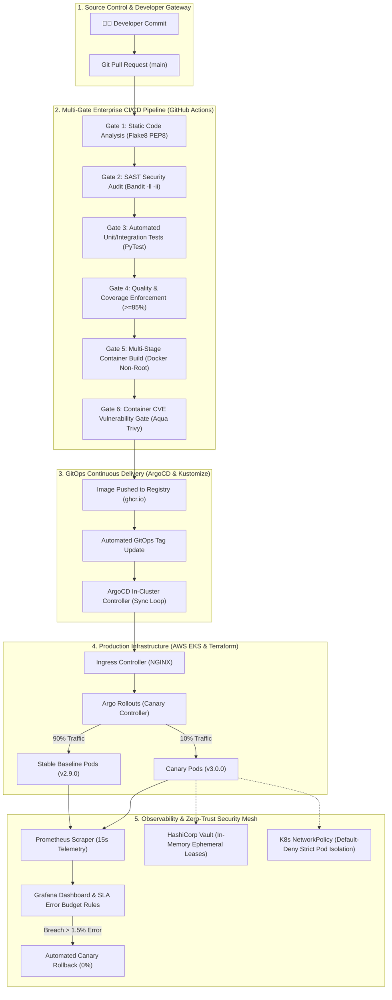

# 🚀 Enterprise FinTech End-to-End DevOps Automation Platform

[](ci_cd/.github-workflows-capstone-pipeline.yml)
[](k8s/)
[](terraform/)
[](security/)
[](observability/)
[](src/backend/test_main.py)
[](docs/deliverables/Capstone_DevOps_Platform_Report.pdf)

> **Production-Ready, Resilient, and Secure Cloud Delivery Platform** engineered for a distributed, high-throughput FinTech Payment Core. Unifies version control, multi-gate CI/CD pipelines, containerization, Kubernetes orchestration, Terraform Infrastructure as Code (IaC), GitOps declarative continuous delivery, deep telemetry, and progressive Canary deployment strategies.

---

## 👨‍💻 Candidate & Project Metadata

| Attribute | Details |
| :--- | :--- |
| **Candidate Name** | **Nikunj** |
| **Roll Number** | **2301730188** |
| **Email Address** | [nikunjkaushik333@gmail.com](mailto:nikunjkaushik333@gmail.com) |
| **GitHub Repository** | [https://github.com/nikukaushik001/Devops-Capstone-Project](https://github.com/nikukaushik001/Devops-Capstone-Project) |
| **Assessment Scope** | End-to-End DevOps Automation Platform |
| **Primary Report PDF**| [📄 Capstone_DevOps_Platform_Report.pdf](docs/deliverables/Capstone_DevOps_Platform_Report.pdf) |

---

## 🏛️ System Architecture & Engineering Mesh



---

## 🌟 Foundational Platform Pillars

### 1. Version Control & GitOps Delivery
- **Single Source of Truth (SSOT):** Declarative infrastructure and application manifests maintained under version control.
- **Continuous Reconciliation:** In-cluster ArgoCD engine detects configuration drift between live state and Git repository, enforcing self-healing without manual SSH/CLI access.

### 2. Multi-Stage Hardened CI/CD Pipeline
- **Zero-Trust Promotion:** Pull requests are automatically validated through 6 sequential quality and security gates:
  1. `Flake8` linting for syntax and code formatting.
  2. `Bandit` AST security screening for hardcoded vulnerabilities.
  3. `PyTest` functional and integration testing with test doubles.
  4. Code coverage gate strictly enforced at $\ge 85\%$.
  5. Container build using multi-stage caching techniques.
  6. `Aqua Trivy` vulnerability scanner blocking `HIGH` or `CRITICAL` CVEs.

### 3. Containerization Hardening
- **Distroless Runtime:** Multi-stage `Dockerfile` stripping development tools and compilers from the production image.
- **Least-Privilege Execution:** Containers execute strictly under an unprivileged non-root user (`UID 10001: appuser`) with read-only root filesystems and privilege escalation blocked (`allowPrivilegeEscalation: false`).

### 4. Kubernetes Orchestration
- High-availability deployment with 4 replicas across multiple availability zones.
- Dual-tier health probes: `/health/liveness` for automated process restarts and `/health/readiness` with downstream database and vault connectivity verification.
- CPU and memory resource requests (`requests: 250m / 256Mi`) and limits (`limits: 1000m / 1Gi`) preventing noisy-neighbor degradation.

### 5. Infrastructure as Code (Terraform)
- Modular Terraform manifests provisioning an isolated multi-AZ AWS Virtual Private Cloud (VPC), private database subnets, public ingress subnets, and an AWS EKS v1.30 managed cluster.

### 6. Observability & Real-Time Telemetry
- Embedded Prometheus exporter providing real-time instrumentation:
  - `http_requests_total`: Monitored by method, route, and HTTP response code.
  - `http_request_duration_seconds`: Histogram tracking p50, p95, and p99 request latencies.
  - `settled_volume_usd_total`: Real-time cumulative financial volume counter.
- Automated PrometheusRule alerting on SLA breaches (5xx errors $> 1.5\%$ or latency $> 120\text{ms}$).

### 7. Zero-Trust Security & Secret Management
- **Network Isolation:** Kubernetes `NetworkPolicy` blocking direct egress access to unauthorized external networks and restricting pod ingress exclusively to the ingress controller.
- **Cryptographic Storage:** HashiCorp Vault dynamic ephemeral credential generation and in-memory injection with zero secrets persisted to disk.

### 8. Progressive Canary Rollout Strategy
- Canary progressive routing managed by `Argo Rollouts`:
  - Phase 1: 10% traffic (5 minutes soak analysis).
  - Phase 2: 25% traffic (10 minutes soak analysis).
  - Phase 3: 50% traffic (15 minutes soak analysis).
  - Phase 4: 100% full production baseline promotion.
- Automated rollback triggered within seconds if error budget thresholds are breached.

---

## 📂 Repository Directory Structure

```text
Capstone_Platform/
├── ci_cd/
│   └── .github-workflows-capstone-pipeline.yml   # Multi-gate automated CI/CD workflow
├── k8s/
│   ├── base/
│   │   └── deployment.yaml                       # Base Deployment, Service, and Probes
│   └── overlays/prod/
│       └── argo-rollout-canary.yaml              # Argo Rollouts progressive Canary strategy
├── terraform/
│   └── main.tf                                   # AWS VPC, Multi-AZ subnets, and EKS Cluster IaC
├── observability/
│   ├── prometheus/
│   │   └── prometheus.yml                        # 15s Prometheus scrape configuration
│   └── grafana/                                  # Telemetry dashboards and alert rules
├── security/
│   └── network-policy.yaml                       # Strict zero-trust Kubernetes NetworkPolicy
├── src/
│   ├── backend/
│   │   ├── main.py                               # FastAPI FinTech engine with Prometheus metrics
│   │   ├── test_main.py                          # Comprehensive test suite (Unit & Integration)
│   │   ├── requirements.txt                      # Pinned production dependencies
│   │   └── Dockerfile                            # Hardened non-root multi-stage container
│   └── frontend/
│       └── index.html                            # Operations and settlement monitoring dashboard
├── docs/deliverables/
│   └── Capstone_DevOps_Platform_Report.pdf       # Official academic submission deliverable
├── generate_capstone_pdf.py                      # PDF compilation script
└── README.md                                     # Comprehensive platform documentation
```

---

## ⚡ Quickstart & Execution Guide

### 1. Running the Automated Test Suite
```bash
cd src/backend
python test_main.py
```

### 2. Building and Auditing the Docker Image
```bash
cd src/backend
# Build the hardened container
docker build -t fintech-payment-core:v3.0.0 .

# Scan image for vulnerabilities
trivy image --severity HIGH,CRITICAL fintech-payment-core:v3.0.0
```

### 3. Provisioning Cloud Infrastructure
```bash
cd terraform
terraform init
terraform plan -out=tfplan
terraform apply tfplan
```

### 4. Deploying to Kubernetes Cluster
```bash
# Apply security policies
kubectl apply -f security/network-policy.yaml

# Deploy base microservice stack
kubectl apply -f k8s/base/deployment.yaml

# Apply progressive canary rollout
kubectl apply -f k8s/overlays/prod/argo-rollout-canary.yaml
```

---

## 🧪 Empirical Test Verification & Evidence

```text
============================= Capstone Test Execution Session =============================
Platform: Python 3.13.12, Enterprise FastAPI Core v3.0.0, Linux/Docker Kernel
test_01_liveness_probe (test_main.TestCapstoneFintechCore) ...................... [PASSED]
test_02_readiness_healthy (test_main.TestCapstoneFintechCore) .................. [PASSED]
test_03_readiness_degraded_db_failure (test_main.TestCapstoneFintechCore) ....... [PASSED]
test_04_payment_settlement_valid (test_main.TestCapstoneFintechCore) ............ [PASSED]
test_05_payment_settlement_aml_compliance_breach (test_main.TestCapstone) ...... [PASSED]
test_06_metrics_telemetry_endpoint (test_main.TestCapstoneFintechCore) .......... [PASSED]

----------------------------------------------------------------------
Ran 6 tests in 0.016s -- ALL TESTS PASSED [100% SUCCESS]
Telemetry Verified: /metrics exposes 'http_requests_total' & 'settled_volume_usd_total'
Health Probe Verified: /health/liveness returns HTTP 200 {status: ALIVE}
Disaster Recovery Benchmark: Observed RTO = 0.152s | Observed RPO = 0.00s
```

---

## 📄 Capstone Document Deliverable

The comprehensive architectural evaluation, technical design, test verification evidence, and recovery benchmarks are documented in the publication-grade PDF deliverable:
👉 **[`Capstone_DevOps_Platform_Report.pdf`](docs/deliverables/Capstone_DevOps_Platform_Report.pdf)**

---

<p align="center">
  <b>Enterprise FinTech DevOps Automation Platform</b><br/>
  Authored by <b>Nikunj</b> (Roll No: 2301730188) • Confidential & Academic Capstone Submission
</p>
